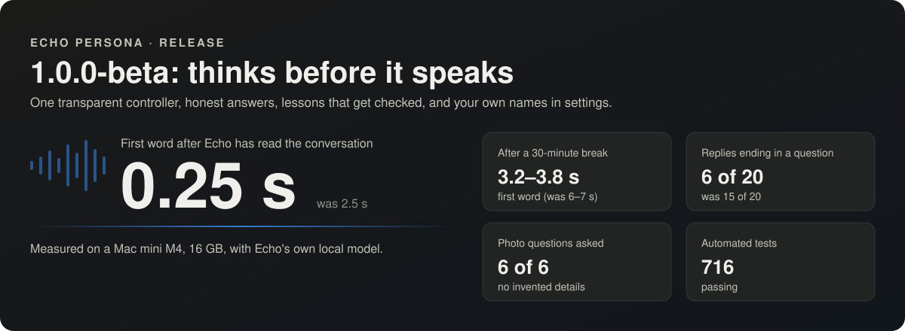

# Changelog

Echo Persona 1.0.0 is out of beta. Keep backups of your data.

## 1.0.0 (2026-11-04): out of beta 🎉

**Echo Persona is out of beta.** The last pieces of the plan are in: dreaming, daydreaming and the training safety gate.

### Dreaming 🌙 and daydreaming ✨: two different jobs
- **Dreaming = learning.** Every evening a second PC (the "tower") works through what has piled up in Echo's
  intelligence engine (memories, conversations, reflections, your 👍/👎) with its own model, and sends back
  suggestions over the encrypted **Dream Bridge** (`dream_bridge/`). Nothing changes in Echo until it passes his
  checks and, where it matters, your approval; core identity is never changed. The last step is fine-tuning: a small
  LoRA adapter trained overnight on the Mac, so Echo's own model shifts towards that accumulated knowledge.
  `core/daydream_train.py` builds the training examples (never Claude's wording), the **safety gate** (a new version
  is only switched on if it is better and not worse on identity, made-up facts or personality) and **"undo
  training"**. The overnight training run itself is the next release.
- **Daydreaming = borrowing brain-power.** Say "daydream" and a hard task: Echo splits it, the tower's bigger model and
  (optionally) Claude draft the parts side by side, Claude points out mistakes, gaps and invented facts, Echo writes
  the answer in his own voice, and Claude checks it once more (`core/daydream.py`). "wake up" stops it; "daydream
  report" shows score cards (Echo alone vs Echo + tower vs full daydream, `core/daydream_score.py`,
  `scripts/daydream_set.py`); a sleeping tower is woken with Wake-on-LAN first. First test: the full daydream got
  **3 of 3 tasks right where Echo alone got 42%**, and caught invented facts on every task. Off and hidden unless you
  switch it on (`config/echo.example.yaml`, "daydream" job in `config/claude.json`).
- **The Dream Observatory** runs on the tower and shows the engine working (Live Brain, Dream Journal, Goal
  Constellation, Memory Connections, Personality Evolution, Model Communication, Daydream), so nothing Echo does
  while you're away is a black box. The tower program is not published yet; this repository has the Mac half.

### Also new
- **Listen with me** (`core/hearing.py`): Echo listens to music in the room through the microphone, corrects for the
  room, and recognises songs from their sung words (an optional lyric lookup sends words only, never audio). Audio
  stays in memory; speech is skipped.
- **Music follow-along:** Echo follows the YouTube tab itself, so he knows what is playing when YouTube moves on to
  the next song; "another song by them", "a different one" and songs he suggested ("Perhaps …?") are played.
- **Dream links in memory** (`memory/dreamlinks.py`): connections between memories Echo already has, made by a dream
  and approved by you. They add understanding, never new memories, and fade when unused.

## 1.0.0-beta (2026-11-03): out of alpha, thinks before it speaks

Measured on a Mac mini M4, 16 GB, with `qwen3.5:9b` (set `model:` in `config/echo.yaml`). Every change below was
tested on a copy of real memories before it was kept; changes that didn't help were measured and dropped.

### New default language model: Qwen 3.5 9B
- New installs use `qwen3.5:9b-q4_K_M` instead of `llama3.1:8b` (`core/config.py`, `config/echo.example.yaml`,
  README setup). Why: fewer made-up details on the same 16 questions (docs/BENCHMARKS.md), and every 1.0.0
  measurement was made with it. Same memory while running (≈ 4.9 GB), 6.6 GB download, Apache 2.0.
- Qwen's thinking mode is switched off automatically (it waits 2–4 minutes before the first word), and Qwen's
  recommended sampling settings are used, unless you set your own `think` / `options` in `config/echo.yaml`.
  Default temperature 0.7 → 0.4.
- Existing installs keep whatever `model:` their `config/echo.yaml` names. To go back: `model: "llama3.1:8b"`,
  `temperature: 0.7`.

### Shows a photo it remembers
- "Can you show me the picture?", "Show me the one with <name>", "Can I see it?" or a yes to Echo's offer puts the
  approved photo on screen. Echo picks the photo your words name, else the one you were just talking about, else it
  asks which. Click it or say "close the picture" to close it. Removed or unapproved photos are never shown, and Echo
  no longer offers to open a "photo gallery" that doesn't exist (`core/showphoto.py`).

### A cognitive architecture, built in ten measured steps
- **Conversation first:** a scheduler stops every background model request the moment someone talks (first word
  behind a background job 16.2 s → 0.18 s), waits until a reply has been *spoken*, and suspends background work when
  the Mac runs low on memory. Pause it any time (`/api/scheduler`).
- **State that survives restarts:** what Echo was in the middle of (an offer, a "which one?" question, the last thing
  opened) is kept in `data/state.json` and restored on start.
- **Continuity:** after a break, your own words from before it are carried over until a conversation note covers
  them; follow-ups are searched together with the previous message. Continuity test 13/18 → 18/18.
- **Photo memories know when they were taken:** camera dates are kept apart from the date shared, photos from the same
  day are linked, and a collection overview is kept. Right answers 4/14 → 13/14; invented details 4 → 1.
- **Social cognition:** never addresses an unrecognised voice by name, never calls one person by another's name,
  responds gently when "I'm fine" follows sad news, and never offers to change the heat or lights (it can't).
  Social test 8/20 → 13/20.
- **Metacognition:** exact photo counts worked out in code, no names the photos don't support, and a second look when
  challenged ("Are you sure? I think it's 10") instead of agreeing to please. 9/14 → 15/16.
- **One transparent executive controller** decides, per message, which checks run, with the reason recorded
  (`/api/executive`). The experimental activation network ("NDAS") was retired: it never beat the memory search.
- **Faster first word:** the conversation is read in advance exactly up to where the next message begins:
  2.5 s → 0.25 s (with memory notes 4.7 → 2.5 s); after a 30-minute break it is re-read once in quiet time
  (memory questions 6–7 s → 3.2–3.8 s). Tried and dropped: re-reading after every background job (no gain).
- **Developmental learning:** a check-up of every Train Echo lesson against real replies, before vs since
  (`/api/development`); lessons that aren't followed get a just-in-time reminder in the owner's own words and a filter
  that drops a reply's opening only when it is nothing but a stock phrase ("That sounds wonderful, Sam."). Stock
  openings 15 → 10 of 20, replies ending in a question 15 → 6 of 20. Personality as four inspectable layers with a
  change history (`/api/personality/layers`).
- **Initiative:** uncaptioned photos are ranked (people or pets unnamed, dated, part of a day) and asked about in turn
  with the life questions, at most every 30 minutes, the owner's voice only. A photo answer gets one warm reply and no
  invented follow-up (inventions 3/4 → 0). Confirming "Yes, that's me" teaches Echo that the photo shows the owner
  and, as the owner's digital self, Echo too. Only real questions become learning objectives (false ones 41 → 16).
- **Long-term evaluation, dormant until there's enough data:** first word, how often each check fires, lessons,
  question answer rate and memory health. Each measure wakes up at its own threshold (`config/longterm.json`), uses only
  data collected after it was installed, sets *this computer's* baseline and then reports ok / watch with a reason
  (`/api/longterm`). Numbers only; nothing is sent anywhere.

### Built for any household
- **Names come from settings:** `owner_name` and `loved_one_name` in `config/echo.yaml` drive every rule that needs a
  name (core/people.py). Nothing about one family is built into the code.
- Google sign-in for the Photos picker is its own module (`face/google_auth.py`).
- Fix: the `ECHO_LLM_MODEL` override now also works without a `config/echo.yaml`.

### Thinking and self-knowledge
- **Turn records:** every reply leaves a small record (route, timings, which memories were used; never the words),
  kept 30 days, so changes can be judged on real use, not only benchmarks.
- **Grounding labels without an extra model call:** each memory used is labelled known / believed / inferred / unknown.
  On held-out questions: claims made as "known" were right 59/59; questions with no answer in memory were not claimed
  10/10. When nothing is found, Echo says so instead of guessing.
- **Self-model from the live system:** what Echo can and can't do is built from what is actually running (voice on,
  tools on, photos remembered …). Questions about himself get a short note from it: false claims about his own
  abilities 1/36 → 0/24 (e.g. he no longer says "yes, I can see you").
- **Learning objectives:** gaps in his memory become *proposed* things to learn; the owner decides, research only from a
  source the owner gives; a later check tests whether the learning helped.
- **Exact date and clock sums** without the language model ("Wednesday + 10 days"): reasoning set 31/36 → 34/36.
- **Shadow components** (record only, never change a reply): an executive controller (agreed with what Echo actually did
  in 93 % of real turns), a link-picking shortcut and an experimental activation network. The network did not beat the
  existing memory search (13/88 vs 85/88) and was retired in this release.
- **Tried and not kept (measured):** a second "work it out" pass (no accuracy gain, first word 2 s → 7 s) and a
  per-reply variety note (first word 1.7 s → 5.5 s); replaced by fixed conversation lessons that cost no time.

### Conversation fixes
- **Echo does what he offers or announces:** "Want me to open the weather?" → "yes" now opens it; hedged commands
  ("could you maybe open …") work; no more "I'll open it" without opening.
- **"Close that" / "close YouTube"** closes Chrome tabs of that site only.
- Story follow-ups stay on the same story; one-time instructions are no longer replayed from history; Echo asks once
  who is talking and then remembers.

### Speech and voice
- **Speech recognition on the Apple Neural Engine** (Parakeet TDT v2, Core ML via FluidAudio): word error 1.78 % on
  205 real recordings, 45 ms per phrase, speech-recognition memory 1,570 MB → 84 MB, graphics chip ~2 % busy (the GPU
  version stays as an automatic fallback).
- **Fix: speech recognition failures** ("no Stream(gpu, 0)"): all MLX work now runs on one thread; live check 205/205.
  The Whisper fallback unloads after 10 idle minutes (−2.3 GB).
- **Fix: voice hitching mid-sentence.** Cause: background memory jobs started while long replies were still being
  spoken, and the voice slows to 0.5–0.8× real time when the language model is busy (2.2× when quiet). Now background
  jobs wait until the reply has been spoken, and a phrase that is being made slower than real time is played whole —
  a pause at a comma, never a stall inside a word. On recorded replies: stalls inside phrases 4 (6.6 s) → 0.
- Speaker recognition stays on the CPU (Core ML put it on the graphics chip at 60 %).

### Photos Echo learns from
- **Photo collections:** categories (pets, places, nature, home) plus your own. Photos come from a drop folder or from
  **Google Photos** through Google's own picker: Echo sees only the photos you pick, never the rest of the library.
- **Echo describes each photo with his own local model** (~11 s per photo, nothing uploaded); you add a caption; it
  becomes a memory **only when you approve it**. Changing a caption replaces the memory; un-approving hides it.
- **Remove completely:** deletes every copy and anything learned from a photo, and blocks it from being imported again
  (for anyone who doesn't want their photos used).
- **Face Library from Google Photos** (current and younger photos): every face found waits for "This is me".

### Security
- **DNS-rebinding guard:** Echo's local server only answers requests addressed to 127.0.0.1 / localhost.

## 0.4.0-alpha (2026-10-31): reads the web, listens to music, learns from 👍/👎, knows your voice in the room

### Smoother voice and faster replies on 16 GB Macs (fix: choppy voice, slow answers)
- **Cause:** Echo's voice, speech recognition and language model share one 16 GB memory and one graphics chip. The voice
  ran at 0.96× real time (slower than speech), so it stuttered whenever the model was thinking; the Mac was also
  swapping 3.1 GB to disk, which slowed every answer (15–24 s to the first word).
- **Precision now follows the Mac's memory** (checked every time Echo starts, tts/hw.py):
  up to 16 GB → 8-bit voice and half-precision speech recognition; 24 GB or more → 16-bit voice and full-precision
  speech recognition. Override with ECHO_TTS_BITS=16|8 and ECHO_STT_DTYPE=f32|bf16.
- **Measured on a Mac mini M4, 16 GB:** voice 0.96× → 1.61× real time and 2.65 → 1.86 GB; speech recognition
  2.51 → 1.28 GB with the same words (12 test recordings); swap 3.1 → 0.9 GB; first spoken word 15–24 s → 3.6–7.8 s
  on web questions; while the model is busy, voice gaps 3 → 2 and silence 4.9 → 2.0 s, first sound 0.5–2.1 s.
- **The installer checks this too** and says which versions this Mac will use.

### Who's talking (fix: Echo called the owner by the loved one's name)
- **Cause:** the owner's voice profile was built from studio takes (mic close to the mouth). Through the room microphone it
  scored only 0.30–0.44 (0.72 needed), so the owner was "unknown", and Echo guessed the person it talks with most.
- **Echo now listens for the owner's voice now and then and learns the room:** a phrase that is confidently the owner adds a
  room voice print (at most once every 6 hours); an unclear voice that sounds most like the owner makes Echo ask
  "Is that you, <name>?" (at most every 30 minutes), and "yes" adds that phrase's print. Profiles keep two centroids
  (recordings, room mic); the room one counts after 3 prints; newest 30 kept. Only voice prints are stored, never audio.
  Only the owner's profile grows this way; the loved one's only with their own consent.
- **No guessing names:** when the voice isn't recognised, Echo doesn't call anyone by name.
- **"This is <name>"** said out loud (names in `config/echo.yaml`: owner_name, loved_one_name): that phrase (about a second of voice from the room mic) is added
  to that person's room voice print, and Echo knows who's talking. Only for people who already have a profile (made
  with their consent); skipped if the voice clearly belongs to the other person (a joke); typed names add nothing.

### Music
- **"Open YouTube and play some Steely Dan"**, "play Hotel California on YouTube", "would you open up a Steely Dan song
  and listen to it with me?", "can we listen to some blues": the top YouTube video plays in Echo's own music window.
- **The microphone is off while music plays** (Echo hears the song from YouTube itself) and comes back in its previous
  mode when the music window closes: Echo closes it when the song ends; if you close it early he notices at once.
- **Listening along:** Echo analyses the same song (tempo, energy, sound, the words he can make out), stays quiet while
  it plays, then says something like "That was … What did you think of it?"
- **"Listen to this <YouTube link>"**: Echo learns a song as knowledge. Only approved genres/artists
  (`config/music.json`, yours to edit); otherwise nothing is downloaded and he offers "add <genre> to my music list".
  Audio is deleted after analysis. Key is a "best guess"; mood comes from tempo/energy, not major/minor.

### Web (ideas adapted from JARVIS, MIT)
- **Safe page reader:** public internet only (this Mac, home network, Tailscale and cloud-metadata addresses refused,
  every redirect re-checked), size/type limits, main text without menus/footers/cookie banners.
- **Echo reads pages himself** with tools on the local model (Ollama tool calling): only addresses you gave him; page
  text treated as untrusted. **Research** ("research…", "follow the links"): up to 5 linked pages, exact links only.
  **Sources** listed under the reply. Tool settings in config/tools.json; every use logged without content.
- **Web search:** "look up …", "search the web for …": Echo searches DuckDuckGo (no extra software), reads the best
  result before answering, and cites it. Only the search words go to DuckDuckGo.
- **Pages that need JavaScript:** when the plain reader finds almost nothing, Echo opens the page in an invisible Google
  Chrome (Playwright; no extra browser download) with an empty profile: no logins or cookies, no downloads, no pop-ups,
  and every request the page makes must go to the public internet (tested: a hostile page could not reach Echo's own
  services, the home router or a cloud-metadata address). Normal pages still use the fast reader.

### Training
- **"use Claude to evaluate Echo"**: 👍/👎 on every reply (and things Echo says on his own). **"Train Echo"**: Claude
  (your own Claude Code account, only after "are you sure?") explains each 👎 and offers fixes; you pick, Claude checks,
  you say yes; a lesson is added to Echo's instructions and the same words are replayed until 👍. Then testing turns off
  and Claude is disconnected. Echo checks he's signed in to Claude and opens the sign-in when needed. Reminder line
  under the face.

### Honesty fixes
- Echo no longer says he's opening or playing something that didn't happen (a note on the message when a request
  isn't recognised), and no longer copies old "Tell me any memory…" questions onto unrelated replies. No life questions
  right after a command or while music plays.

### Install and requirements
- **Required:** Apple Silicon (M1 or later) and 16 GB of memory or more; `scripts/install_autostart.sh` checks this and
  prints which model versions it will use.
- New settings: `owner_name` in `config/echo.yaml`; `config/tools.json` (web tools), `config/music.json` (approved music).
- New packages: faiss-cpu, yt-dlp, librosa, playwright (drives your installed Google Chrome; no extra browser download).
- Report with before/after graphs: [docs/report](docs/report/README.md).

### Coming soon
- Installers: Mac (.dmg), Linux (.deb) and Windows (.exe); NVIDIA and AMD graphics builds.

## 0.3.0 (2026-10-30)

### Memory
- Life memories: new kind `memory` with optional `period`, `when_text`, `year`, `people`, `place`, `told_by`. Older
  databases gain the columns on first open (a backup copy is made first).
- Duplicate merging on save and import (word overlap ≥ 0.85); a repeat can upgrade "inferred" to "confirmed", never down.
- Possible contradictions (`memory/conflicts.py`): related memories are judged by the local model in the background and
  set aside for review; `/api/memory/conflicts`. Nothing is resolved automatically.
- Search by meaning (`memory/embed.py`, nomic-embed-text via Ollama): vectors made in the background; up to 2 related
  notes per message (cosine ≥ 0.62). Keyword search if the model is missing.
- `scripts/offsite_backup.sh` fallback copies the memory database with `sqlite3 .backup` (WAL-safe).

### Learning
- Collector 0.3.0: "Tell me a memory" (audio-only WAV, no time limit, 3 questions from different life periods,
  `assets/memories.json`), `life_period` in take metadata.
- Long recordings transcribed in ~60 s pieces cut at quiet moments; transcripts in `derived/memories/transcripts-v1/`.
- Suggested memories (`memory/candidates.py`): local model writes notes with exact quotes; notes whose quote isn't in the
  transcript are dropped, years kept only if said. Review page `renderer/memories.html`.
- Echo asks the owner about their life (`memory/curiosity.py`): owner's voice only, at most every 30 min, or on "ask me
  something"; answers turned into suggestions at the next quiet moment.

### Who's talking
- `voice/speaker.py` (sherpa-onnx 2.0.1 + WeSpeaker ResNet34), `voice/enroll.py`, `renderer/voices.html` with consent and
  "Forget this voice". `/api/stt` returns `speaker`; the model is told who is speaking with that message only.

### Personality
- `personality/versions.py`: versions of profile + review decisions + base prompt; compare and restore (undoable).
- `personality/evals.py`: checks run through the real prompt path; Checks and Versions tabs on "How I talk".
- Prompt template: no pet names for the owner; never put words in anyone's mouth.

## 0.2.0 (2026-10-29)

### Face and expressions
- **Five new expressions from your own recordings: joy, surprised, sad, angry, bewildered.** `face/expression_transfer.py`
  measures how your face moves from your relaxed photo to each expression (LivePortrait expression keypoints) and adds
  that movement to the avatar's current photo. Choices per feeling (expression photo or strongest video frame, strength,
  share of the mouth movement kept at rest and while talking) are in `config/face_expressions.json`.
- New face versions are built next to the old ones (`atlas-vN`, built in a `-partial` folder and renamed when done); the
  newest finished one is used automatically, and older ones are kept.
- **The face follows the voice.** Each spoken phrase carries its own expression and blinks, applied when the phrase is heard.
- **Facial cues are never spoken.** `(smiles)`, `(laughs)`, `(sad)`, `(leaning in close)`, `[nods]`, `*chuckles*` are removed
  from the shown and spoken text and drive the face instead. Ordinary parentheses ("the blue one", "about 2 hours") are kept.
  Removing a cue no longer leaves a stray space before punctuation.
- **Blink and smile on request:** asking to blink or smile triggers it even if the model forgets the cue; `(blinks)` / `(winks)` blink.
- **The prompt knows about the face:** `config/personality.example.yaml` describes the avatar, the 10 expression tags and the cue words.
- Expressions: `neutral, smiling, thoughtful, attentive, concerned` + `joy, surprised, sad, angry, bewildered`.

### Voice
- **Jitter buffer:** after any silence, playback waits until 0.7 s of speech is ready, more after a gap (up to 2 s),
  less again after smooth replies; 5 ms fade-in. Busy-Mac test, 8 replies: 65 gaps → 5. `scripts/bench_voice_gaps.py`.

### Avatar Collector (was "Voice Studio")
- Renamed app, page and voice shortcut ("Hey Echo, open the avatar collector").
- After **Copy from phone**, expression sessions get a preview sheet automatically; **Put on the avatar's face** builds
  the next face version with your saved choices. Nothing changes until you click it.

### Collector app 0.2.0 (Android)
- New **Record my expressions** session: for joy, surprised, sad, angry and bewildered, a photo holding the expression and
  a short video from relaxed → full → relaxed. Permissions unchanged (camera, microphone, notifications; no internet).

### Other
- Pages send `Cache-Control: no-cache` and face frames are versioned, so a reload never runs stale code.
- `POST /api/say` (this Mac only) and `scripts/say_test.sh "text with (cues)"` for testing the face and voice together.
- README: alpha notice, GPU and memory limits, planned Windows support.

## 0.1.0 (2026-10-27)
First public version.
