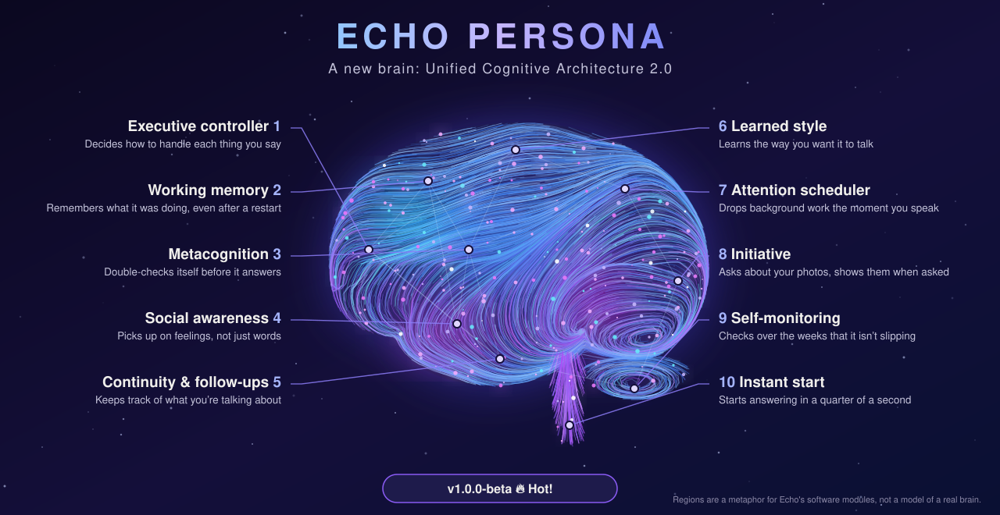
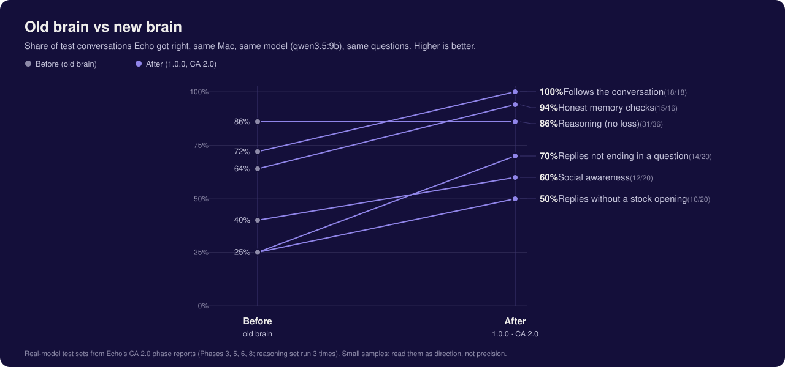
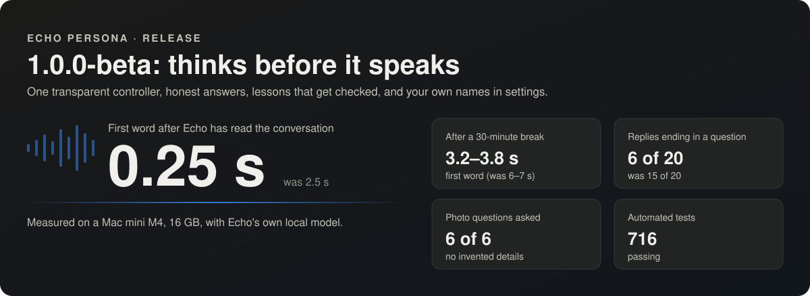
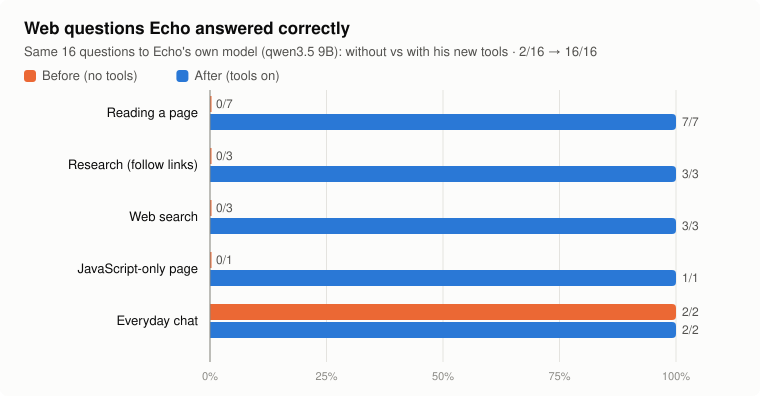
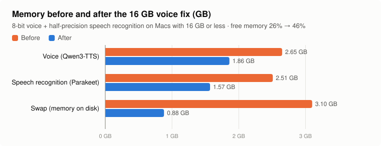

# Echo Persona

<p align="center"></p>

> [!CAUTION]
> **Echo is now able to open web pages, read their contents, listen to music and make evaluations. These functions
> are protected, but they can be manipulated by an outside LLM. bruceatterberry-design is not liable or responsible
> for abuse, and strictly prohibits this kind of modification.**

A private, local "digital self" for your Mac: a talking companion that speaks in **your voice**, shows **your face**,
remembers what you tell it, and talks the way you do. It's made to be left for someone you love.

Everything runs on your own Mac. Recordings, photos, memories and conversations never leave it. Echo only reaches the
internet when you ask it to (read a web page, look something up, play or listen to a song), and Claude is used only
if you switch it on; see Privacy.

- **Talks and listens:** say "Hey Echo, …" or use push-to-talk. Local speech recognition (Parakeet / Whisper) and a
  local language model (Qwen 3.5 9B via Ollama). Replies stream, so it starts speaking within a few seconds.
- **Your voice:** record about 30 minutes in the built-in **Avatar Collector**; Echo clones your voice from your best takes
  (Qwen3-TTS, zero-shot, no training run needed).
- **Your face:** add a few photos; Echo renders a talking, blinking face from one of them (LivePortrait, offline).
  The mouth follows the voice as it plays.
- **Remembers:** say "remember that …" or use the memory panel. Nothing is saved without being asked.
- **Talks like you:** the "How I talk" page proposes personality traits from your own recorded answers, each backed by a
  quote; only the ones you approve are used.
- **Opens and reads web pages:** "Hey Echo, open the Weather Channel", "what does example.com say?", "look up when the
  Eiffel Tower was built", "research … and follow the links". Echo reads pages itself and lists its sources.
- **Music:** "open YouTube and play some blues"; Echo listens along (tempo, energy, the words it can make out) and
  talks about the song afterwards. The microphone is off while music plays.
- **Android Collector app (optional):** guided daily sessions that record your voice and face video on your phone, and
  copy to the Mac over a USB cable only (the app has no internet permission).

> **🎉 Out of beta: 1.0.0.** Echo Persona is complete and covered by 902 automated tests. It has so far been
> used on one Mac, so keep backups of your recordings (`scripts/backup_dataset.sh`) and please report problems.

## What's new in 1.0.0 🎉 Out of beta

**Echo Persona is out of beta.** Every part of the plan is built: voice, face, memories, the Dream Engine link, the
Dream Observatory and Daydream.

🌙 **New: [a guided tour of the Dream Observatory](docs/DREAM_OBSERVATORY.md)**, every window explained with pictures.

### Dreaming and daydreaming: two different jobs
| | **Dreaming** 🌙 | **Daydreaming** ✨ |
|---|---|---|
| When | every evening, by itself | only when asked: "daydream" + a hard task |
| Where | a second PC (the "tower") with its own model, over Echo's memories | Echo on the Mac + the tower's bigger model + (optionally) Claude |
| What it's for | **learning**: reinforcement and fine-tuning, so Echo's own model gradually fits everything gathered in his intelligence engine | **borrowing brain-power**: harnessing outside LLMs for one hard question and feeding the result back to the Mac, in Echo's own voice |
| What changes | Echo himself, slowly and only through checks | one answer, right now |

- **Dreaming** is how Echo learns. At night the tower works through what has piled up (memories, conversations,
  reflections, your 👍/👎) and sends back suggestions and training examples. The last step is fine-tuning: a small
  LoRA adapter trained overnight on the Mac, so the weights of Echo's own model shift towards that knowledge and
  personality. A new version is only switched on if it beats the old one and is not worse on identity, made-up facts
  or personality; "undo training" always goes back. Claude's wording never goes into the training data.
- **Daydreaming** ✨ is how Echo thinks harder in the moment: he splits the task, the tower's model and Claude draft the
  parts side by side, Claude hunts for mistakes and invented facts, and Echo writes the answer himself. In the first
  test the full daydream got **3 of 3 tasks right where Echo alone got 42%**. "wake up" stops it, "daydream report"
  shows the scores, and a sleeping tower is woken first.

### The Dream Observatory (on the tower)
A window on the tower that shows the engine working, so nothing Echo does while you're away is a black box: **Live
Brain** (a 3D brain lit by the current stage, plus a "Daydream active" box), **Dream Journal**, **Goal
Constellation**, **Memory Connections**, **Personality Evolution** (every proposed change, with evidence; core identity
is never changed) and **Model Communication** (every message between the tower and the Mac).

**Optional Claude account:** with your own Claude account switched on, Claude drafts, critiques and checks each
daydream. It sees only the task text, never your memories, and has a daily cap. If it's off, Echo carries on with the
tower and himself.

> **What's in this repository:** the Mac half: Echo, the encrypted Dream Bridge (`dream_bridge/`), Daydream
> (`core/daydream*.py`) and the training safety gate. The tower's Dream Engine and Observatory are a separate program
> that is not published yet. Daydream is **off and hidden** unless you set `daydream.enabled` and your Mac's id in
> `config/echo.yaml` (copy `config/echo.example.yaml`) and switch on the "daydream" job in `config/claude.json`.
> Also new: **listen with me** (Echo listens to music in the room with you and recognises songs from their words).

## What's new in 1.0.0-beta 🔥 Hot!

**A new brain.** Version 1.0.0 gives Echo a new way of thinking, called the *Unified Cognitive Architecture*
(CA 2.0). Instead of one big step, each message now goes through ten small parts that work together. The numbers
below match the numbers in the picture at the top. Each part is drawn on the area of the brain that does a similar
job in people. That's only a comparison: Echo is software, not a brain.

1. 🧭 **Executive controller** (front of the brain): *decides how to handle each thing you say.* Like a person
   deciding "this is a question about the past, let me think back", Echo picks the right checks for each message
   and keeps a note of why.
2. 🗂️ **Working memory** (front of the brain): *remembers what it was doing, even after a restart.* If Echo asked
   "Would you like to see it?" and the computer restarts, it still knows what "yes" means.
3. 🔍 **Metacognition**, or "thinking about its own thinking" (middle of the brain): *double-checks itself before
   it answers.* It says "I'm not sure which one" instead of guessing a name, counts photos exactly, and doesn't
   back down from a correct answer just because someone pushes.
4. 💜 **Social awareness** (deep inside, where feelings are handled): *picks up on feelings, not just words.* When
   someone says "I'm fine, really" right after sad news, Echo is gentle instead of cheerful.
5. 🧠 **Continuity and follow-ups** (the memory centre): *keeps track of what you're talking about.* Ask "what season
   was it taken in?" and Echo knows you still mean the photo you were just discussing, even after a break.
6. ✍️ **Learned style** (the area for practised skills): *learns the way you want it to talk.* When you teach Echo a
   lesson ("don't end every reply with a question"), it checks whether it actually follows it.
7. 🎯 **Attention scheduler** (the area that decides what to focus on): *drops background work the moment you speak.*
   Echo tidies its memories when it's quiet, but you always come first.
8. 📷 **Initiative** (the seeing area at the back): *asks about your photos, and shows them when asked.* It might ask
   "Who is in this picture?", and when you say "Can you show me the picture?" it puts the photo on the screen.
9. 📈 **Self-monitoring** (the area for fine-tuning, at the back and bottom): *checks over the weeks that it isn't
   slipping.* Once it has enough conversations it compares each week with your own normal, quietly, on your Mac.
10. ⚡ **Instant start** (the brainstem, for automatic reactions): *starts answering in a quarter of a second.* Echo
    reads the conversation ahead of time, so the first word comes in 0.25 s instead of 2.5 s.

### 🆕 New default language model: Qwen 3.5 9B

New installs now start with **Qwen 3.5 9B** instead of Llama 3.1 8B. The language model is the part of Echo that
puts words together, a bit like the voice of its thinking. In plain terms, here's what changes for you:

- **Fewer made-up details.** On the same 16 tricky questions, Qwen invented details less often than Llama. When
  Echo doesn't know something, it's more willing to say so.
- **It's the model Echo was tested with.** Every number on this page, including the new brain's results, was
  measured with Qwen 3.5 9B on a 16 GB Mac.
- **About as fast once it's warmed up** (first word about 1.6 s in a running conversation), and it uses about the
  same memory while running (≈ 4.9 GB), so it still fits on a 16 GB Mac. The download is bigger: 6.6 GB instead of
  4.9 GB.
- **"Thinking mode" stays off.** Qwen can think silently before answering, but that takes 2–4 minutes before the
  first word. Echo switches it off automatically.
- **Simpler license:** Apache 2.0.

**Already using Echo?** Nothing changes until you choose to switch. To switch, run
`ollama pull qwen3.5:9b-q4_K_M` and set `model: "qwen3.5:9b-q4_K_M"` in `config/echo.yaml`. To keep or go back to
Llama, set `model: "llama3.1:8b"` and `temperature: 0.7`.

### Old brain vs new brain



| Measure (real model, same Mac, same questions) | Before (old brain) | After (1.0.0, CA 2.0) |
|---|---|---|
| Follows the conversation | 13/18 (72%) | **18/18 (100%)** |
| Honest memory checks (names, counts, corrections) | 9/14 (64%) | **15/16 (94%)** |
| Reasoning (3 runs; checks nothing got worse) | 31/36 (86%) | **31/36 (86%)** |
| Replies not ending in a question | 5/20 (25%) | **14/20 (70%)** |
| Social awareness | 8/20 (40%) | **12/20 (60%)** |
| Replies without a stock opening | 5/20 (25%) | **10/20 (50%)** |
| First word while background work is running | 16.2 s | **0.18 s** |
| Automated tests | 411 passed (0.4.0) | **716 passed** |

The samples are small, so read them as direction, not precision.



### All the details

- **Starts talking sooner:** Echo now reads the conversation in advance exactly up to where your next message begins,
  so a reply only has to read what's new: first word **2.5 s → 0.25 s** (with memory notes 4.7 → 2.5 s). After a
  30-minute break it re-reads once while it's quiet: memory questions **6–7 s → 3.2–3.8 s**. Conversation always
  comes first: background work stops the moment someone talks.
- **One transparent controller:** for every message Echo decides which checks to use (memory honesty, exact counts,
  social notes, date sums, self-knowledge) and records why, never the words. See `/api/executive`.
- **Remembers where you were:** after a break, your own words from before it are carried over; follow-ups like "what
  season was it taken in?" stay on the topic.
- **Honest when it matters:** says "I don't know which one" instead of guessing a name in a photo, counts exactly
  ("six photos mention Milo"), keeps a correct answer when challenged, and is gentle after sad news.
- **Your lessons, checked:** Echo measures whether each Train Echo lesson is actually followed in real conversation
  (`/api/development`) and helps the ones that aren't: replies ending in a question 15 → 6 of 20 in testing.
- **Asks about your photos:** uncaptioned photos become questions ("I have a photo from May 2011 of a smiling man. Is
  that you?"); your answer waits for your review. When it's you, Echo understands that it is you and, as your
  digital self, Echo too.
- **Watches itself over time:** a built-in long-term check stays dormant until it has enough of *your* data, then
  compares each week with your own baseline (`/api/longterm`). Numbers only; nothing leaves your Mac.
- **Your household, your names:** every rule that needs a name (who may be addressed by name, "This is <name>", stock
  openings) reads `owner_name` and `loved_one_name` from `config/echo.yaml`; nothing is built in.

Measured on a Mac mini M4 (16 GB) with `qwen3.5:9b`. Full details: [CHANGELOG](CHANGELOG.md).

## What's new in 0.4.0-alpha
- **Reads the web by itself, on your Mac's own model:** give Echo an address and ask what it says; ask it to research
  (it follows up to 5 links) or to look something up (DuckDuckGo). It answers from the pages and lists **Sources**
  under the reply. Pages that need JavaScript open in an invisible Chrome with an empty profile.
- **Safe by design:** only addresses you gave (or exact links on pages it read when you asked it to research); web
  pages can never reach Echo's own services, your home network or a cloud-metadata address (every redirect and every
  request is checked); page text is treated as information, never as instructions; every tool use is logged without
  content (`/api/tools`, `config/tools.json`). Ideas adapted from [JARVIS](https://github.com/bertrandmbanwi/Jarvis) (MIT).
- **Music:** "play … on YouTube" opens it in Echo's own music window, mutes the microphone while it plays and brings it
  back when the window closes; Echo listens along and talks about it. "Listen to this <YouTube link>" teaches Echo a song
  from an approved list of genres/artists (`config/music.json`; audio is deleted after analysis).
- **Train Echo:** say "use Claude to evaluate Echo" to get 👍/👎 on every reply; then "Train Echo" lets Claude (your own
  Claude Code account, only after you confirm) explain each 👎 and suggest fixes. You choose, Claude checks the choice,
  you say yes; the fix becomes a rule in Echo's instructions and the same question is asked again until you're happy.
- **Knows your voice in the room:** Echo learns room-microphone voice prints ("This is <name>", or "Is that you?" when
  unsure) and never guesses a name when it isn't sure.
- **Smoother voice on 16 GB Macs:** voice and speech recognition precision now follow the Mac's memory (8-bit voice and
  half-precision speech recognition up to 16 GB; full precision from 24 GB). Measured: first spoken word on web
  questions 15–24 s → 3.6–7.8 s, swap 3.1 → 0.9 GB.
- **More honest:** Echo no longer says it opened or played something that didn't happen (false claims 8 → 0 in testing).
- Memory: a fast meaning index for large memories, nightly integrity-checked backups with restore drills, and
  **Learn** from files and web pages (kept separate from your own memories).

**Before / after, with Echo's own model on a Mac mini M4 (16 GB)** · full report: [docs/report](docs/report/README.md)





All features were measured with `qwen3.5:9b`, the default since 1.0.0 (set `model:` in `config/echo.yaml` to use
another Ollama model).

## What's new in 0.3.0
- **Life memories.** Memories can carry when they happened (childhood, teens, young adult, adult, recent; year; your
  own words), who was there and where. Repeats are merged instead of piling up, and memories that may contradict each
  other are set aside for you to decide (Keep 1 / Keep 2 / Both are true); nothing is overwritten automatically.
- **Search by meaning** with a small local model (`ollama pull nomic-embed-text`, 274 MB): a question finds related
  memories and past conversations even when they share no words. Falls back to keyword search without it.
- **"Tell me a memory" on the phone** (Collector 0.3.0): audio-only stories, 3 questions per session from different
  times of life. After "Copy from phone", Echo transcribes them and suggests memories, each with your exact words as
  evidence. Review them on the new **My memories** page (fix, keep or reject, replay the recording, life-story view).
- **Echo asks you about your life**, now and then, but only when it recognises *your* voice (or when you say "ask me
  something"). Your answers become suggestions on My memories.
- **Who's talking:** local speaker recognition (sherpa-onnx + WeSpeaker, 26.5 MB) tells the owner's voice from the
  loved one's; the loved one adds their voice on the **Who's talking** page with their consent. See docs/SPEAKERS.md.
- **Personality versions and checks:** every change to "How I talk" can be compared and undone, and a small set of
  checks (honesty, identity, no pet names for the owner, no invented quotes, short replies) runs through the real prompt.

## What's new in 0.2.0
- **Five new expressions from your own recordings:** joy, surprised, sad, angry and bewildered. Record them with the
  Collector app's new **Record my expressions** session (about 3 minutes). Echo measures how your face moves from
  relaxed to each expression and carries that movement onto your avatar's photo, so everything else about the photo stays
  the same. You pick the strength and how much of the mouth to keep (`config/face_expressions.json`).
- **The face follows the voice:** each spoken phrase carries its own expression, and the face changes as you *hear* it.
- **Facial cues are never read aloud:** when the language model writes `(smiles)`, `(laughs)`, `(sad)`, `[nods]` or
  `*chuckles*`, the words are removed and the face shows the expression instead. Normal parentheses are kept.
- **Blink and smile on request:** "Blink for me" and "smile for me" work even if the model forgets the cue.
- **Echo knows it has a face:** the personality prompt describes the avatar and the cue words, so it no longer claims
  to be "text only".
- **Smoother voice:** a small playback buffer removes most of the choppiness when the Mac is busy (65 → 5 gaps in a
  test of 8 replies while the language model was still writing).
- **Voice Studio is now Avatar Collector:** voice recording, copying from the phone, and expression previews in one
  place. "Put on the avatar's face" builds a new face version; nothing changes until you click it.
- Fixes: pages are never served from a stale browser cache; a half-built face is never loaded.

Full list: [CHANGELOG.md](CHANGELOG.md).

> Echo Persona is a personal project, not a product. It is honest about being a digital self built from what you chose to
> share, not a living person.

## Requirements
- **Required:** a Mac with Apple Silicon (**M1 or later**) and **16 GB of memory or more**. Tested on a Mac mini M4 with
  16 GB. The installer checks this and stops on an Intel Mac or with less than 16 GB, and tells you which model
  versions it will use: up to 16 GB, the 8-bit voice and half-precision speech recognition; 24 GB or more, the full-precision
  versions (override with `ECHO_TTS_BITS=16|8` and `ECHO_STT_DTYPE=f32|bf16`).
  Echo currently runs on **macOS only**; see *GPU and memory* below and *Windows* (planned).
- About 20 GB free for models, plus room for your recordings. An external SSD for the data is recommended.
- Google Chrome (Echo's window is a Chrome app window).
- [Homebrew](https://brew.sh).
- Optional: an Android phone (Android 8+) for the Collector app.

### GPU and memory
On a Mac, the GPU shares the computer's memory ("unified memory"), so all of Echo's models have to fit in RAM together
with macOS and Chrome. Measured on a Mac mini M4 with 16 GB:

| Part | Model | Memory while loaded | Speed |
|---|---|---|---|
| Thinking | Qwen 3.5 9B (4-bit, Ollama; 6.6 GB download) | ≈ 4.9 GB | ≈ 18 tokens per second |
| Your voice | Qwen3-TTS 0.6B (MLX) | ≈ 2.6 GB | ≈ 1.3× faster than real time on its own |
| Listening | Parakeet TDT 0.6B v2 (MLX) | ≈ 2.6 GB | ≈ 0.13 s per question |
| Face builds (offline, not while chatting) | LivePortrait (PyTorch MPS) | peak ≈ 5 GB | ≈ 1.3 s per frame, ≈ 10 min per face |

Limitations to know about:
- **16 GB is the minimum, and it is tight.** With everything loaded, about 10 GB is in use before macOS and Chrome. If
  the Mac starts swapping, replies slow down and the voice can stutter. Close other heavy apps, and don't build a new
  face while you're talking to Echo.
- **The language model and the voice share one GPU.** While the model is still writing an answer, voice generation
  slows to below real time, so Echo waits a moment (0.7–2 s) to buffer speech before talking. More GPU cores
  (M-Pro/Max) and **24 GB or more** give noticeably smoother speech.
- **8 GB Macs are not supported**: the models alone don't fit.
- Disk: about 20 GB for models, plus about 30 MB per face version and whatever your recordings take.

### Coming soon
- **Installers:** a Mac installer (**.dmg**), a Linux package (**.deb**) and a Windows installer (**.exe**).
- **NVIDIA and AMD graphics builds**, for PCs with a dedicated GPU.

### Windows (planned, not yet available)
A future version may support Windows 10/11 with an **NVIDIA GPU** (CUDA). The language model would run through Ollama
and the voice, listening and face models through their PyTorch/CUDA versions instead of Apple's MLX. Expected needs,
estimated from the Mac measurements and **not yet tested**:
- **Minimum:** NVIDIA RTX GPU with **8 GB of video memory** (e.g. RTX 3060 8 GB, 4060) and 16 GB of system RAM. With
  8 GB, the models can't all stay on the GPU at once, so expect slower replies.
- **Recommended:** **12–16 GB of video memory** (e.g. RTX 3060 12 GB, 4070, 4080) so the language model, voice and
  listening models stay loaded together.
- AMD GPUs: an AMD build is coming (see *Coming soon*). Intel GPUs are not planned for now.

## Install
```sh
git clone https://github.com/bruceatterberry-design/echo-persona.git ~/EchoPersona
cd ~/EchoPersona
brew install uv ffmpeg ollama
uv sync && (cd tts && uv sync)
brew services start ollama   # or: ollama serve
ollama pull qwen3.5:9b-q4_K_M   # Echo's language model (6.6 GB)
ollama pull nomic-embed-text   # memory search by meaning (274 MB)
mkdir -p models/speaker && curl -L -o models/speaker/wespeaker_en_voxceleb_resnet34.onnx \
  https://github.com/k2-fsa/sherpa-onnx/releases/download/speaker-recongition-models/wespeaker_en_voxceleb_resnet34.onnx   # who's talking (26.5 MB)
scripts/build_face_tools.sh       # Apple Vision face finder (Swift)
```
Download the speech and voice models once (about 5 GB; Echo runs offline afterwards):
```sh
cd ~/EchoPersona/tts
HF_HOME=../models/hf uv run python -c "from huggingface_hub import snapshot_download as d; \
  [d(r) for r in ('mlx-community/parakeet-tdt-0.6b-v2', 'mlx-community/Qwen3-TTS-12Hz-0.6B-Base-bf16')]"
```
Settings: copy `config/echo.example.yaml` to `config/echo.yaml` and set where your data lives (`dataset_root`,
for example a folder on an external SSD) and the name of the person Echo will mostly talk with. Copy
`config/personality.example.yaml` to `config/personality.yaml` and fill in the parts in `<angle brackets>`.

Then make Echo start by itself at login and add **Echo Persona** to /Applications:
```sh
scripts/install_autostart.sh
```
Open **Echo Persona** and click **Allow** when Chrome asks for the microphone. To undo: `scripts/uninstall_autostart.sh`
(your data is untouched).

More detail: [docs/PC_SETUP.md](docs/PC_SETUP.md), [docs/MODEL_SETUP.md](docs/MODEL_SETUP.md).

## Make it you
1. **Voice.** Click **Avatar Collector** (or run `scripts/make_studio_app.sh` to put an **Avatar Collector** app on the Dock).
   Read the prompts, Keep the good takes, and aim for about 30 kept minutes. Then:
   ```sh
   uv run python scripts/make_voice_reference.py
   launchctl kickstart -k gui/$(id -u)/com.echopersona.voice
   ```
2. **Face.** Put a few clear, front-facing photos of yourself in `<dataset_root>/staging/face/photos-current/`, open
   **My face**, press Scan, mark your face **This is me** and star the best one. Set up LivePortrait once
   ([docs/PC_SETUP.md](docs/PC_SETUP.md)), then run `scripts/build_face.sh` (about 10 minutes) and reload Echo's window.
3. **Personality.** Answer the "about me" prompts in the Avatar Collector (or the Collector app), then open **How I talk**,
   press Update, and approve the traits that sound like you.
4. **Expressions (new in 0.2.0).** On the phone, run **Record my expressions** (and at least one normal session, which
   takes the relaxed "straight on" photo used as the starting point). After **Copy from phone**, Avatar Collector makes a
   preview of each feeling on your face. Check it, adjust `config/face_expressions.json` if needed (photo or video,
   strength, how much of the mouth to keep), then click **Put on the avatar's face** (about 10 minutes) and reload Echo's window.
5. **Memories.** Tell Echo "remember that …", or add them in **What I remember**.

### Collector app (Android, optional)
Download **EchoPersonaCollector.apk** from the [Releases](../../releases) page. With USB debugging on
([docs/ANDROID_SETUP.md](docs/ANDROID_SETUP.md)) and the phone plugged in:
```sh
brew install android-platform-tools
scripts/install_collector.sh ~/Downloads/EchoPersonaCollector.apk
```
Record sessions on the phone, then plug it in and press **Copy from phone** in the Avatar Collector. Every file is checked
against its fingerprint before the phone may delete it. To build the app yourself: `cd collector-android && ./gradlew assembleDebug`.

## Opening web pages
"Hey Echo, open the Weather Channel", "go to apple dot com", "open Chrome to example dot org". Requests are recognised
before the language model sees them, so Echo only opens addresses that were actually said or saved as shortcuts; it
never invents one. Shortcuts live in `config/browser.json`. To open a site as a particular Google account, add
`?authuser=` to its address; for two people sharing one Mac, a plain "YouTube" can ask whose:
```json
{"say": "Sam's YouTube", "names": ["sam's youtube"], "url": "https://www.youtube.com/?authuser=sam@example.com"},
{"say": "Pat's YouTube", "names": ["pat's youtube"], "url": "https://www.youtube.com/?authuser=pat@example.com"},
{"say": "YouTube", "names": ["youtube"], "ask": "Sam's YouTube or Pat's?",
 "answers": {"sam's": "Sam's YouTube", "pat's": "Pat's YouTube"}}
```

## Privacy
- **When Echo goes online (only when asked):** it fetches the web pages you name (or exact links on them when you ask it
  to research), sends search words to DuckDuckGo when you ask it to look something up, and contacts YouTube when you ask
  it to play or listen to a song. Nothing about you, your memories or your recordings is sent with these requests;
  the invisible browser starts with an empty profile each time.
- Every service listens on `127.0.0.1` only; nothing is reachable from the network. See [docs/SECURITY.md](docs/SECURITY.md).
- Original recordings and photos are stored read-only with SHA-256 checksums; consent is recorded before any recording.
- Run `scripts/backup_dataset.sh` after recording sessions; `scripts/offsite_backup.sh` makes an encrypted copy for
  another drive ([docs/BACKUP_AND_RECOVERY.md](docs/BACKUP_AND_RECOVERY.md)).
- **Optional Claude helper (off by default):** if you have Claude Code installed, the Status page can let it speed up a
  few slow background jobs (personality updates and summaries), and **Train Echo** uses it only after you say "Train Echo"
  and confirm (it sends just the replies you marked 👎, your notes and Echo's basic instructions, never memories). Each
  job is switched on separately and sends only that job's text. Live conversation, audio, photos and your voice never leave the Mac.
- Only clone a voice or face with that person's clear consent. Echo asks for it before the first recording.

## Troubleshooting
See [docs/TROUBLESHOOTING.md](docs/TROUBLESHOOTING.md). Quick checks:
```sh
launchctl list | grep echopersona          # the 4 background parts
curl -s 127.0.0.1:8765/health              # brain, memory, speech recognition
uv run pytest -q                           # automated tests
```

## License
MIT; see [LICENSE](LICENSE). Third-party models and libraries keep their own licenses:
[docs/THIRD_PARTY_LICENSES.md](docs/THIRD_PARTY_LICENSES.md) (for example, Parakeet is CC-BY-4.0 and needs attribution to NVIDIA,
and Qwen 3.5 is Apache-2.0).
