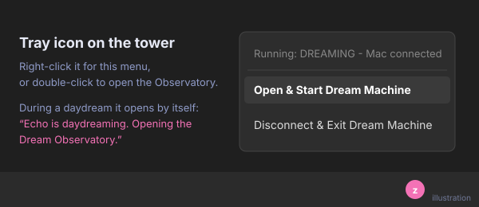
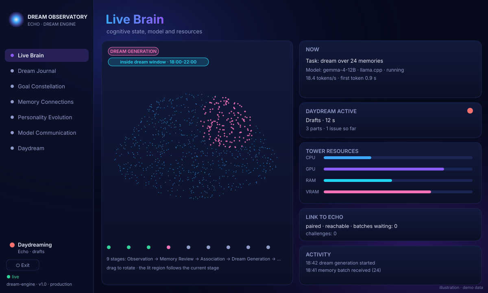
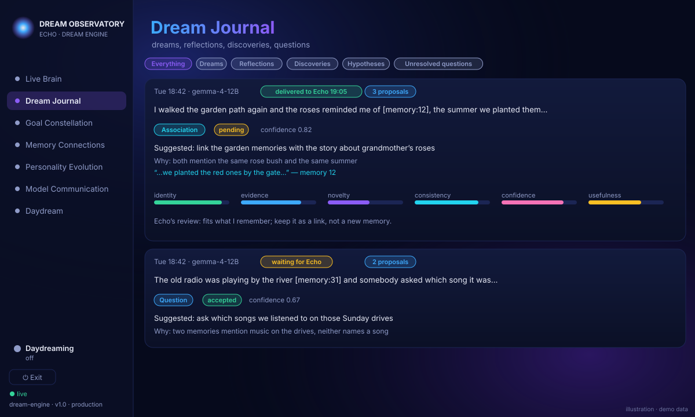
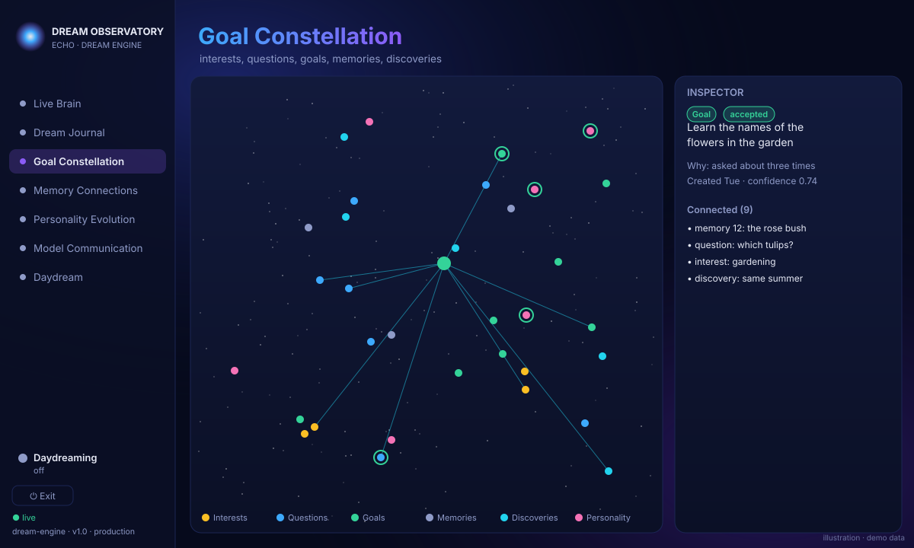
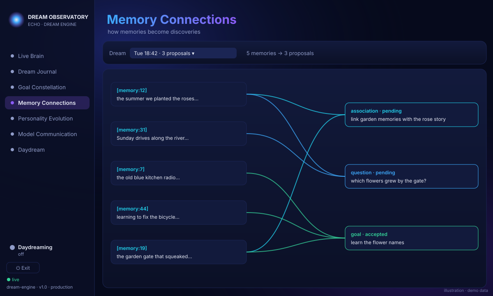
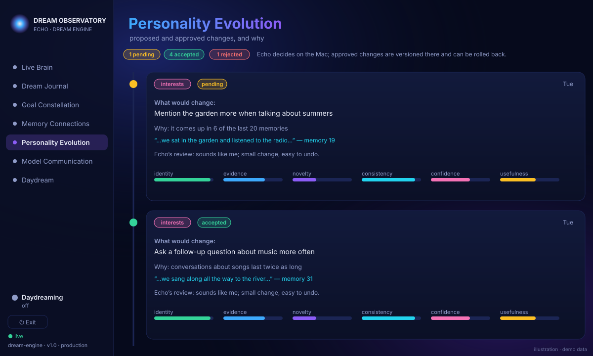
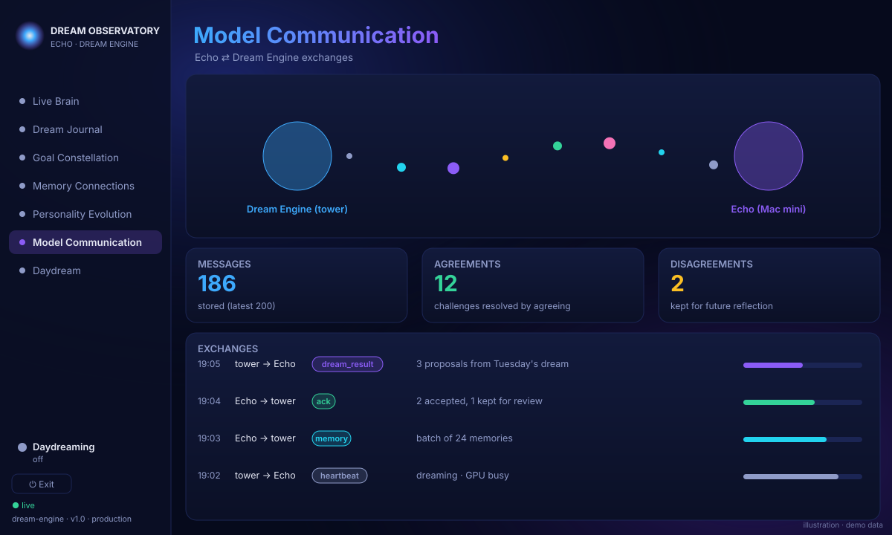
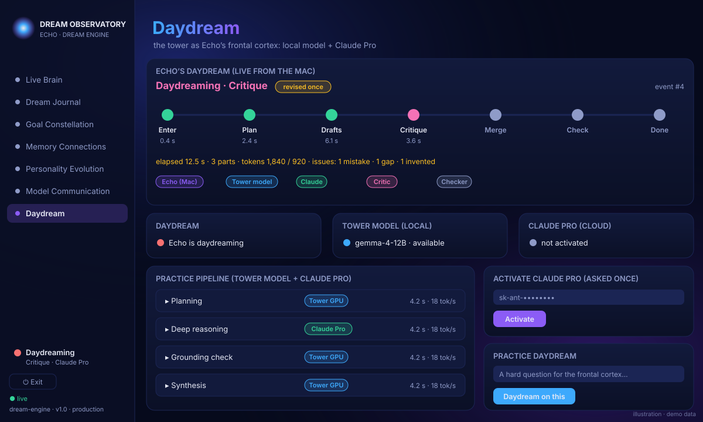

# 🌙 The Dream Observatory

The Dream Observatory is a window into Echo's mind. While Echo rests, a second PC (the "tower") **dreams** over his
memories, and when you ask for help with something hard, Echo **daydreams** with the tower and, optionally, Claude.
The Observatory shows all of it as it happens: what Echo dreamt, which memories led to each idea, what changes are
being suggested and why, and every message between the tower and the Mac.

**Why it exists:** Echo is meant to keep growing long after the people who built him stop tinkering. What he does
while nobody is talking to him should never be a black box. With the Observatory you can watch it work, read the
evidence behind every suggestion, and say no.

| | **Dreaming** 🌙 | **Daydreaming** ✨ |
|---|---|---|
| **What it's for** | **Learning.** Reinforcement and fine-tuning, so Echo's own model on the Mac slowly fits everything gathered in his intelligence engine | **Borrowing brain-power.** Outside models help with one hard question, and the result comes back to the Mac in Echo's own voice |
| **When** | Every evening, 18:00–22:00, by itself | Only when you ask: "daydream" + a hard task |
| **What changes** | Echo himself, slowly, and only after his checks and your approval | One answer, right now |

> The pictures on this page are **illustrations with made-up demo data**, drawn from the Observatory's real layout and
> colours. They are not screenshots of anyone's real memories.

---

## Opening the Observatory: the menu system

<table>
<tr>
<td width="50%"></td>
<td>

**1. The tray icon.** On the tower, a pink brain with "zzz" sits by the clock.

- **Right-click** it for the menu. At the top is a status line, for example *Running: DREAMING - Mac connected*.
  Below it are **Open & Start Dream Machine**, which starts the engine if needed and opens the Observatory, and
  **Disconnect & Exit Dream Machine**.
- **Double-click** it to open the Observatory straight away.
- **During a daydream it opens by itself** with the tip *"Echo is daydreaming. Opening the Dream Observatory."* and
  goes straight to the Daydream page.

</td>
</tr>
</table>

**2. The sidebar.** The Observatory fills the screen. On the left is a sidebar headed **DREAM OBSERVATORY · ECHO ·
DREAM ENGINE** with one button per page, top to bottom:

**Live Brain · Dream Journal · Goal Constellation · Memory Connections · Personality Evolution · Model
Communication · Daydream**

At the bottom of the sidebar are:

- the **Daydreaming** light (off, or the current daydream stage)
- **⏻ Exit**, which closes only the window; the engine keeps dreaming
- **● live**, the connection light

Each page also has its own address, such as `…/observatory/#brain`, which works only on the tower itself.

---

## The modules

<table>
<tr>
<td width="55%"></td>
<td>

### 🧠 Live Brain
*"cognitive state, model and resources"*

A 3D brain made of thousands of glowing points. It turns slowly, and you can drag it to rotate it. The region for
the current step lights up, and pulses travel across it as things happen. Along the bottom are the **nine dream
stages**, from Observation to Persistence.

On the right, from top to bottom:

- **Now:** the current task, the model and its speed
- **Daydream active:** a red light that blinks during a daydream
- the tower's **CPU, GPU and memory**
- the **link to Echo**
- a live **activity** feed

**Sidebar → Live Brain**

</td>
</tr>
<tr>
<td></td>
<td>

### 📖 Dream Journal
*"dreams, reflections, discoveries, questions"*

Every dream Echo has had, newest first. Each card shows:

- the dream's story, with the memories it drew on highlighted
- whether it has reached Echo yet
- each suggestion it produced, with:
  - **why** it was suggested
  - **quoted evidence**
  - **Echo's own review**
  - six score bars: identity, evidence, novelty, consistency, confidence and usefulness

The buttons at the top filter the list: Dreams, Reflections, Discoveries, Hypotheses or Unresolved questions.

**Sidebar → Dream Journal**

</td>
</tr>
<tr>
<td></td>
<td>

### ✨ Goal Constellation
*"interests, questions, goals, memories, discoveries"*

Echo's inner world as a star map. Each colour is one kind of star:

- amber: interests
- blue: questions
- green: goals
- grey: memories
- cyan: discoveries
- pink: personality

A green ring means you accepted it, and a red ring means you didn't. **Click a star** to light up everything it is
connected to. The **Inspector** on the right then shows its history and evidence. Click a legend item to hide or
show that kind of star.

**Sidebar → Goal Constellation**

</td>
</tr>
<tr>
<td></td>
<td>

### 🔗 Memory Connections
*"how memories become discoveries"*

Pick a dream from the list at the top and see exactly **which memories fed which ideas**. Memories are on the left,
the dream's suggestions are on the right, and curved lines join them, coloured by kind. Hover over a box to make
its lines glow.

This is where you can check that an idea really came from something Echo remembers.

**Sidebar → Memory Connections**

</td>
</tr>
<tr>
<td></td>
<td>

### 🌱 Personality Evolution
*"proposed and approved changes, and why"*

A timeline of every suggested change to how Echo talks and what he cares about. Each card shows:

- **what would change** and **why**
- the evidence behind it
- Echo's review
- whether it is pending, accepted or rejected

**Core identity, values and permissions are never proposed.** Changes about relationships always need your approval.
Echo decides on the Mac, and every approved change is versioned there and can be rolled back.

**Sidebar → Personality Evolution**

</td>
</tr>
<tr>
<td></td>
<td>

### 📡 Model Communication
*"Echo ⇄ Dream Engine exchanges"*

The conversation between the two machines. Two orbs, the **Dream Engine (tower)** and **Echo (Mac mini)**, have
coloured dots travelling between them, one per message. Three counters show **Messages**, **Agreements** and
**Disagreements**. Disagreements are kept for future reflection, not thrown away.

Below them, the **Exchanges** list shows every message: which way it went, what kind it was, and how confident it
was.

**Sidebar → Model Communication**

</td>
</tr>
<tr>
<td></td>
<td>

### ✨ Daydream: Echo thinks harder, on request! ✨
*"the tower as Echo's frontal cortex: local model + Claude Pro"*

Say **"daydream"** and a hard task, and this page **comes alive**. It opens by itself and follows each step live:
**Enter → Plan → Drafts → Critique → Merge → Check → Done.**

- **Drafts:** the tower's model and Claude draft the parts **side by side**.
- **Critique:** Claude hunts for **mistakes, gaps and invented facts**.
- **Merge:** Echo writes the answer **in his own voice**.
- **Check:** Claude checks it once more.

The page also shows the timings, the token counts, every issue caught, and which helpers are working.

In the first test, the full daydream got **3 of 3 tasks right where Echo alone got 42%**! It caught invented facts
on every task.

Below the live view:

- a **practice pipeline**, where you can try a daydream from the tower
- the place to **activate the optional Claude Pro account**, which is asked once and can be deleted at any time

**Sidebar → Daydream**, or it opens by itself.

</td>
</tr>
</table>

---

## Optional: supercharge it with a Claude account

The tower and Echo work fine on their own. With your Claude account switched on, Claude drafts, critiques and
checks every daydream, which is what lifted the accuracy above. Claude only ever sees the task text, never your
memories, and has a daily limit. If it is off or the limit is reached, Echo carries on with the tower and himself.
Claude's wording is never used to train Echo's own model.

> **What's in this repository:** the Mac half: Echo, the encrypted Dream Bridge and Daydream. The tower's Dream Engine
> and the Observatory are a separate program that has not been published yet.
