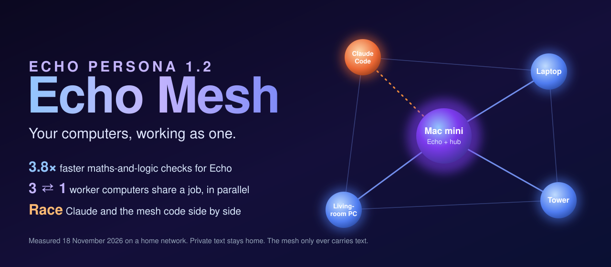
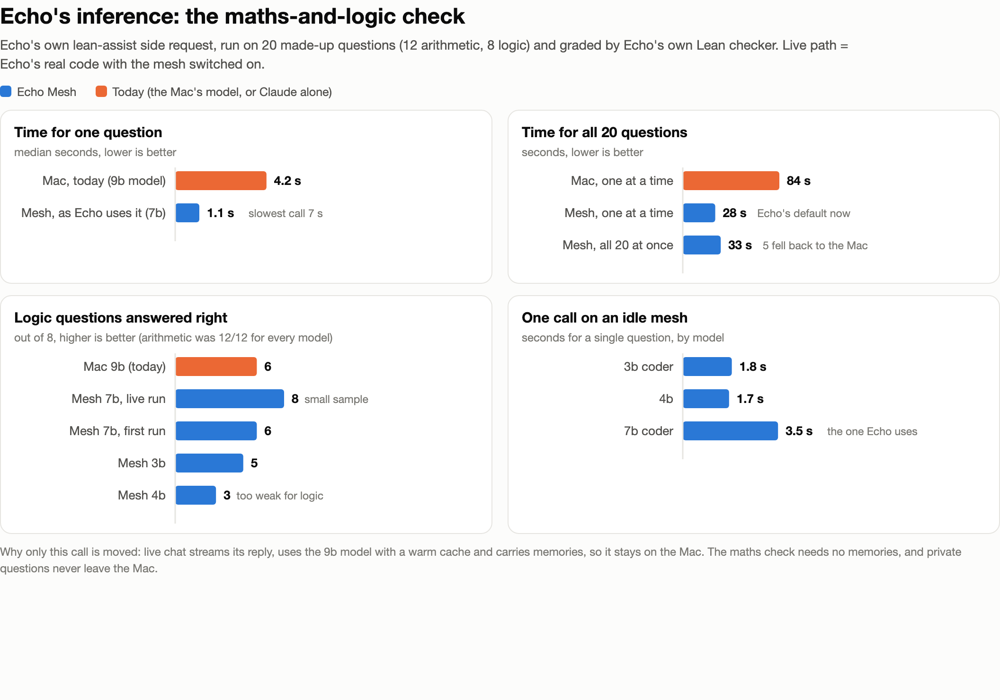
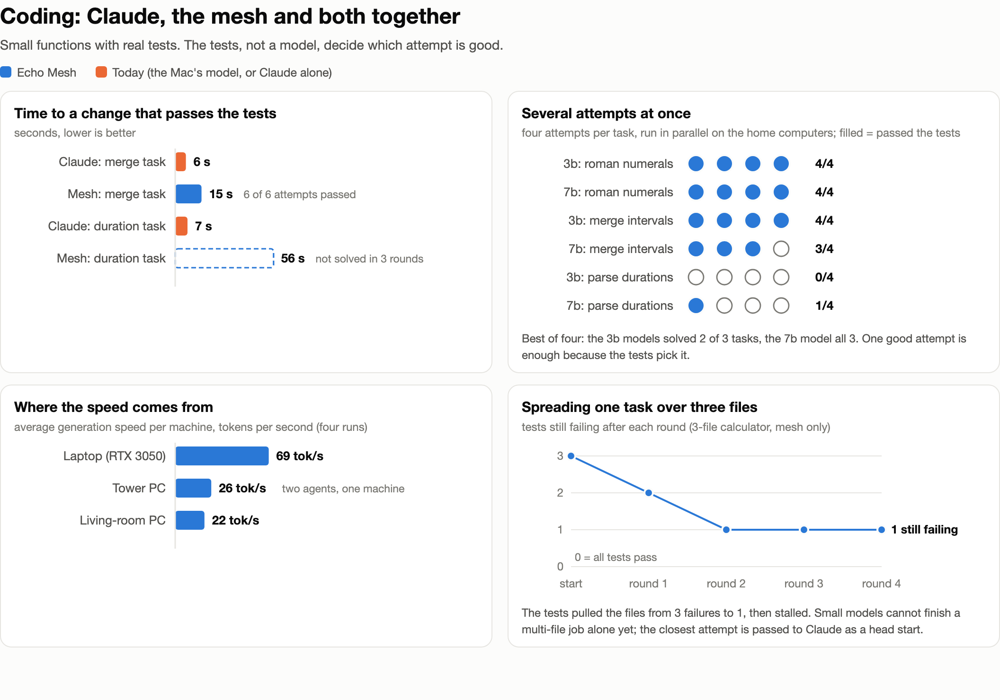

# 🕸️ Echo Mesh: Echo's team of computers

<p align="center"></p>

> **One Mac was never meant to do everything.** Echo Mesh turns the ordinary computers in your home (the laptop in the
> drawer, the tower in the corner, the PC in the living room) into a **private team that works for Echo**. Small jobs
> fan out to all of them at once. Claude Code and your own computers **race** to write your code. And if one side is
> down, the other keeps going.

**It is private, invite-only and opt-in.** A computer joins only when *you* press Yes on a matching 4-digit number. The
Mesh carries **text and nothing else**: never memories, recordings, photos or files, and it never runs a command on any
computer.

---

## ⚡ The numbers (measured, not promised)

Everything below was measured on one home network: a Mac mini (Echo and the hub), a laptop with an RTX 3050 GPU, a
tower PC and a living-room PC. Charts for every number: **[Echo-Mesh-Performance.pdf](report/Echo-Mesh-Performance.pdf)**.

| | Today (Mac alone) | **With the Mesh** |
|---|---|---|
| Echo's maths-and-logic check, one question | 4.2 s | **1.1 s** (3.8× faster) |
| Twenty questions, one after another | 84 s | **28 s** |
| Accuracy on the same 20 questions | 12/12 sums, 6/8 logic | **12/12 sums, 8/8 logic** |
| Writing a passing code change (small task) | Claude: 6 s | Mesh: 15 s, **6 of 6 attempts passed** |
| "Best of four" attempts on 3 small tasks | n/a | **3b models solved 2 of 3, the 7b model 3 of 3** |

<p align="center"></p>

<p align="center"></p>

> [!NOTE]
> **Honest numbers.** These are small samples (20 questions, 3 coding tasks): a one- or two-answer gap is noise. For a
> small coding task **Claude alone was faster** (6 s against 15 s). The Mesh's wins are throughput, Echo's side-requests,
> and *never being stuck*: when Claude is down or out of usage the Mesh keeps coding. The charts show the failures too
> (a three-file job went from 3 failing tests to 1 and stalled).

---

## 🧠 Echo leans on the Mesh for inference

Echo's chat stays exactly where it is: on your Mac, with its 9B model, its warm cache and its memories. **But Echo also
makes small side-requests all day**, and those don't need the Mac's GPU. The first one moved to the Mesh is the
**maths-and-logic check**: when you ask a sum or a "does this follow?" question, Echo has a small model translate it into
something Lean 4 can check exactly.

**What happens now:**

1. Echo sends that one short request to a computer on the Mesh (a 7B model), **one at a time**.
2. Lean 4 verifies the answer **on the Mac**. The Mesh's reply is only ever text that is parsed by a strict grammar. It is
   never run as code.
3. If the Mesh is down, slow (over 12 seconds), missing the model or returns nonsense, **the Mac answers exactly as it
   did before.** It is never worse than not having a Mesh.

**Private text stays home.** A request that names anyone Echo knows, mentions school or students, or contains an email,
phone number or street address is never offered to the Mesh. A separate limited token lets Echo hand over text jobs and
read its own answers, and that is all it can do: it cannot approve, pause or remove a computer, read message boards or
change settings.

The Mac's GPU is left free for talking to you. Switch it off any time with `"enabled": false` in `config/meshoffload.json`
(no restart) or `SWEETIE_MESHOFFLOAD=0`. The reference client is in
[`echo-mesh/integrations/echo/`](../echo-mesh/integrations/echo/): copy it next to any small side-request you want to
offload.

---

## 💻 Code faster: Claude Code + the Mesh

Echo Mesh ships a small launcher, **`mclaude`**, for [Claude Code](https://www.anthropic.com/claude-code) (installed
and signed in separately; Echo itself never talks to Claude unless you switch that on). Every time you start it, it
checks both sides and picks the best mode:

| Claude Code | Mesh | What you get |
|---|---|---|
| ✅ up | ✅ up | **Claude with superpowers**: four extra tools let Claude hand small, tested jobs to your computers and get a verified diff back |
| ✅ up | ❌ down | **Plain Claude**, exactly as if the Mesh did not exist |
| ❌ down or out of usage | ✅ up | **The Mesh takes over**: a `mesh>` prompt where your own computers write the code |
| ❌ | ❌ | Says so and stops |

### 🏁 Race mode: Claude vs the Mesh
`meshcode` starts Claude Code **and** the Mesh on the same task at the same moment. Each works in a scratch copy of your
project. **The first result that passes your tests wins** and the other is stopped. It prints a speed report: time per
side, attempts per computer, tokens per second. `--full` lets both finish so you can compare real times.

### 🧪 The tests are the judge
Small models are poor judges of code; tests are not. The Mesh writes several attempts **in parallel on different
computers**, each attempt is tried in its own scratch copy, and **your tests pick the winner**. Nothing in your real
folder changes until you apply the diff.

### 🌐 Spread mode: one big task, several files
`--split` plans a job per file (with the exact names the files use to talk to each other), gives **every file its own
parallel attempts**, and lets the count of failing tests pull the files into line, round after round.

### Tools Claude gets (`mesh_*`)
- **`mesh_try_patch`**: a small change, several attempts, tests choose, a diff comes back. If the Mesh gets close but doesn't
  finish, you get its closest attempt as a head start, clearly labelled *not passing yet*.
- **`mesh_fanout`**: one prompt over many items in parallel (docstrings, summaries, test ideas).
- **`mesh_ask_all`**: a quick second opinion from every computer (often confidently wrong; Claude is told so).
- **`mesh_status`**: who is online.

> [!IMPORTANT]
> The test command is fixed by whoever starts the session, never by a tool call. Secret-looking files and prompts are
> refused. Mesh answers are always treated as drafts. The Mesh sees only the text of the files you name.

---

## 🛡️ Safe by design

- **Invite-only.** Join with a matching 4-digit number that the new computer and the hub both show. Pause or remove any
  computer any time.
- **Text only.** No memories, recordings or photos ever travel. The Mesh runs no commands.
- **Your computer, your rules.** Each computer enforces its own share limit, puts its owner's work first, and verifies a
  signed brain update before using it.
- **Private text stays home** (see above) and outside computers can never receive your jobs.
- **Duplicate-install protection** pauses a copied install instead of letting two machines share one identity.

---

## 🔧 Bug fixes in this build

- **Windows agent didn't start at login (fixed).** Python 3.12 on Windows locked a folder created from an administrator
  shell so the normal user's startup task couldn't read it, and the agent then claimed it was "not enrolled". Folders now
  inherit the user's own permissions on Windows, and an unreadable identity file reports its real cause.
- **Agents now keep a log.** Timestamped lines for connection changes, jobs and the share-limit state (never a secret) go
  to `agent.log` / the system journal.
- **Failing tests were miscounted.** A pytest plugin's warnings after the summary line hid the real count, so spread mode
  couldn't tell progress from none. Counts are read from the real summary, and models now see the real traceback.
- **Runaway code can't hang a run.** A model's endless loop used to stall a run for over 15 minutes; test processes now
  run in their own group and are killed on a 60-second limit, children included.
- **Models can finally see the tests.** Before, 18 attempts out of 18 failed on a task the same models solved once the
  tests were in the prompt.
- **Closest attempt is kept.** A failed Mesh run no longer throws away its best try; it is handed to Claude as a head start.
- **The tool server is robust.** Several tool calls run side by side, and calls in flight still get answered when input closes.
- **Echo's side-request is never worse.** Slow or broken Mesh answers fall back to the Mac, and a second request while one
  is out goes straight to the Mac instead of waiting in line.
- **Board posts keep their line breaks** and service errors are shown in plain words.

---

## 🚀 Try it

```bash
cd echo-mesh
python3 -m mesh.coordinator                      # the hub (on the Mac that runs Echo)
sh installers/arch/install.sh                    # a Linux laptop joins (approve the 4-digit number on the hub)
# Windows: build installers/windows (see its README) or use a released EchoMesh-Setup.exe, then approve the number
python3 tools/ask_all.py --list                  # who is online
python3 tools/ask_all.py --compare "your question"
python3 tools/meshcode.py "make parse_duration handle '1h30m'" --files sol.py     # race Claude vs the Mesh (needs tests)
python3 tools/meshcode.py "build a CLI over three files" --split --files a.py b.py c.py
tools/mclaude --probe                            # what would start, and why
```

`MCLAUDE_PYTHON=/path/to/python` points `mclaude` at a Python that has `pytest`. `MCLAUDE=off` style shortcuts (a shell
function that runs `mclaude` for interactive `claude`) are described in `echo-mesh/tools/mclaude`.

## 🧭 Honest limits
- Small models are not Claude. Hard, multi-file work still needs Claude; the Mesh is for speed, parallel drafts, small
  tested jobs and being a safety net.
- Models that matter (the 7B coder) may live on only one of your computers. If it is off, Echo's side-request simply
  runs on the Mac, which is today's speed, not a failure.
- Asking for 20 things at once overloads a small mesh (5 of 20 waited past the limit in our test). Echo asks one at a time.
- A Windows PC that doesn't sign in by itself after a restart keeps its agent off until someone signs in.
- Backup replies for live chat (when the Mac's model is down) are a prototype, not part of this release.

*Details: [`echo-mesh/README.md`](../echo-mesh/README.md), [`echo-mesh/docs/PROTOCOL.md`](../echo-mesh/docs/PROTOCOL.md),
[`echo-mesh/docs/DESIGN.md`](../echo-mesh/docs/DESIGN.md). 228 automated tests.*
