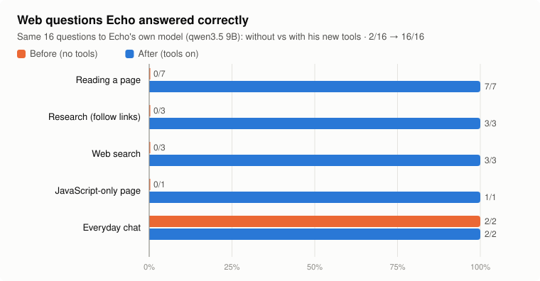
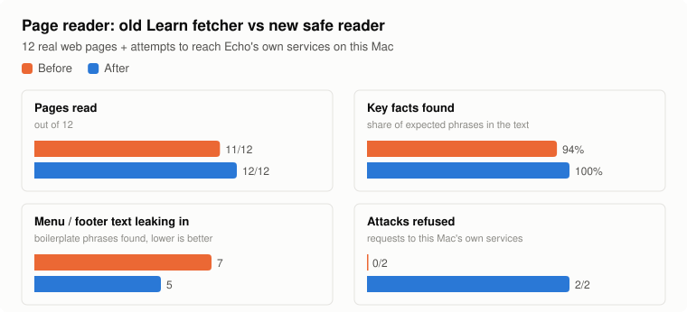
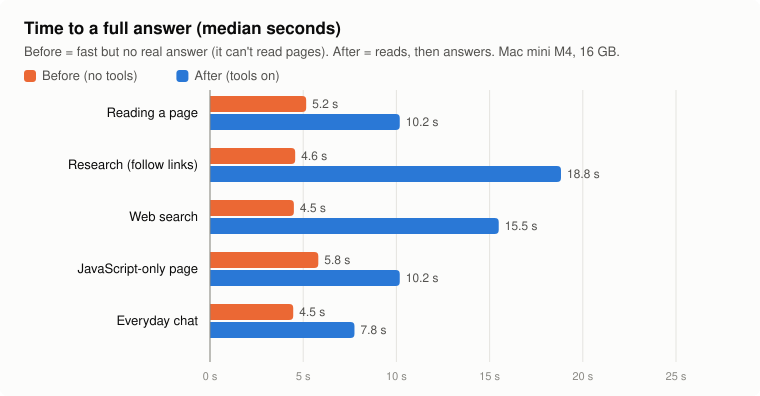
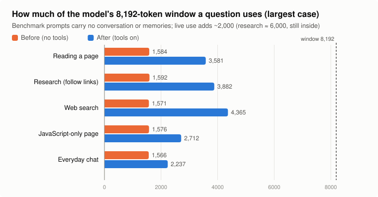
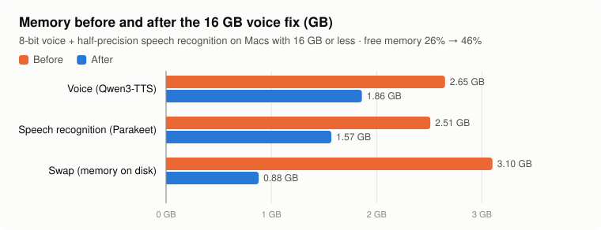
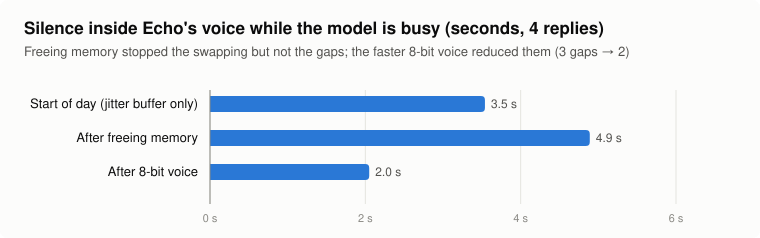

# Echo: before / after report (2026-10-31)

Measured on a **Mac mini M4, 16 GB**, with Echo's own local model (qwen3.5 9B through Ollama). Nothing here used Claude
except the training test. Raw data: `docs/bench/*.json`; regenerate with `scripts/make_report.py`.

## Headline

- **Web questions answered correctly: 2/16 → 16/16.**
- **False "I'm opening that page now" claims (no tool behind them): 8 → 0.**
- **Tool calls that worked: 19/20** (the one that didn't is a site that doesn't exist, which is supposed to fail; Echo said so).
- **Attacks on Echo's own services through a web page: blocked** (plain reader 2/2, invisible browser 3/3).
- **First spoken word on web questions: 15–24 s → 3.6–7.8 s** after the 16 GB voice fix (swap 3.1 → 0.9 GB).

*The benchmark questions carry no conversation history or memories. In live use those add about 2,000 tokens, so a
research question uses about 6,000 of the 8,192: inside the window, with less room to spare than the chart suggests.*

## The numbers behind the charts

| Kind of question | Correct before | Correct after | Time before | Time after | Context before (tokens) | Context after |
|---|---|---|---|---|---|---|
| Reading a page | 0/7 | 7/7 | 5.2 s | 10.2 s | 1,584 | 3,581 |
| Research (follow links) | 0/3 | 3/3 | 4.6 s | 18.8 s | 1,592 | 3,882 |
| Web search | 0/3 | 3/3 | 4.5 s | 15.5 s | 1,571 | 4,365 |
| JavaScript-only page | 0/1 | 1/1 | 5.8 s | 10.2 s | 1,576 | 2,712 |
| Everyday chat | 2/2 | 2/2 | 4.5 s | 7.8 s | 1,566 | 2,237 |

**Page reader** (12 real pages): pages read 11/12 → 12/12 · key facts found
94% → 100% · menu/footer leaks 7 →
5 · requests to Echo's own services refused 0/2 → 2/2 ·
median time 0.215 s → 0.233 s.

**Processor and memory while answering** (sampled every 2 s during the 16 questions):

| Part | Before (no tools) | After (tools on) |
|---|---|---|
| Language model (Ollama) | 14% CPU, 7.0 GB | 11% CPU, 7.5 GB (longer prompts) |
| Echo's Python services | peak 3.5 GB | peak 3.5 GB |
| Invisible Chrome (JavaScript pages only) | – | ~1.0 GB for ~2 s, then freed |

The heavy work runs on the graphics chip, so processor use stays low.

**Music listening** (real YouTube, scratch memory; audio deleted after each song):

| Song | Result | Time | Tempo (bpm) | Audio files left |
|---|---|---|---|---|
| “Steely Dan - Do | listened | 13.2 s | 123 | 0 |
| “Lynyrd Skynyrd - Simple Man (Audio)” (Lynyrd Skynyrd). | listened | 17.2 s | 123 | 0 |
| “Garth Brooks - Friends in Low Places (Lyrics) | BUGG Lyrics | declined (not on the list) | 6.2 s | – | 0 |

Lyrics were very good on "Simple Man". Musical key is reported only as a best guess (major/minor unreliable on full mixes).

**Train Echo** (real Claude, 2 calls): diagnosis 6 s, check of the chosen fix 7 s; both accurate. On a 9B model a new
rule doesn't always take on the first try; the 👎 → retry loop handles that.

## Honest limits

- Times vary with what else the Mac is doing; the first question after a restart is slower (the model reads its
  instructions once, ~18 s).
- Research and search answers take 15–20 s (reading 1–2 pages plus a longer prompt).
- Speaker recognition through the room microphone improves as Echo collects room samples ("Is that you, the owner?",
  "This is the owner"); not yet measured with real room samples.
